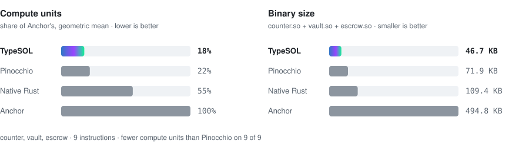

<p align="center">
  
</p>

<h3 align="center">Write Solana programs in TypeScript. Ship native SBF.</h3>

<p align="center">
  <a href="https://github.com/typesol-lang/typesol/actions/workflows/ci.yml"></a>
  <a href="LICENSE"></a>
  <a href="https://www.npmjs.com/package/@typesol/cli"></a>
  
</p>

<p align="center">
  <a href="https://typesol.com">Website</a> ·
  <a href="https://typesol.com/docs/">Docs</a> ·
  <a href="https://typesol.com/docs/changelog/">Changelog</a> ·
  <a href="#numbers">Benchmarks</a> ·
  <a href="docs/language.md">Language reference</a> ·
  <a href="https://x.com/type_sol">X</a>
</p>

TypeSOL compiles a TypeScript subset straight to Solana bytecode. It does not use an interpreter or a VM on chain, and
it does not generate Rust. Your `.ts` file is typechecked by the TypeScript compiler, lowered to C, and built with the
same LLVM toolchain that `cargo-build-sbf` uses. Every build also writes an **Anchor-compatible IDL**, so Anchor
clients read TypeSOL programs unchanged.

- **One language, end to end.** You write the program and its tests in TypeScript, and every build writes a typed
  client for it ([docs/client.md](docs/client.md)). Your editor gives you completion and type errors throughout.
- **Safe by default.**
  - Every arithmetic operation is checked.
  - Account owner, discriminator, signer, writability and aliasing checks are generated from your parameter types.
  - Constraints follow Anchor's rules and use Anchor's error codes.
- **Small and fast.** In the LiteSVM benchmarks below, TypeSOL uses 5–32% of Anchor's compute units, with binaries
  about 10× smaller, and fewer compute units than native Rust and hand-tuned Pinocchio on every instruction. On
  mainnet the results differ by instruction; see [the mainnet table](#on-mainnet).
- **Checked against mainnet.** Eight deployed programs are ported in full, among them Marginfi v2, Phoenix v1 and
  SPL Stake Pool, and run beside the original binaries: the same outcomes, log lines, events and account bytes on
  thousands of transactions, for fewer compute units ([the ports](#ported-and-checked-against-mainnet-binaries)).
- **Verifiable.** `typesol verify` reads a deployed program from the cluster and checks it, and the IDL published on
  chain, against its source. Every release records the hashes of its npm tarball and of every program it builds
  ([releases/](releases), [docs/testing.md](docs/testing.md#reproducing-a-release)).

<p align="center">
  <a href="#numbers">
    <picture>
      <source media="(prefers-color-scheme: dark)" srcset="assets/readme/benchmarks-dark.svg">
      
    </picture>
  </a>
</p>

## Ported and checked against mainnet binaries

Each port is the whole program, written in TypeSOL from the original's source. Its tests send every transaction to
the port and to the binary deployed on mainnet, both in LiteSVM, and require the same outcome, error, log lines,
events, return data and bytes in every account; the port must also use fewer compute units on every transaction that
succeeds. A case study for each says what was compared and what was not.

| Program | Kind | Instructions | Transactions compared |
| --- | --- | ---: | ---: |
| [Marginfi v2](docs/case-study-marginfi.md) | Anchor, lending | 124 | 2,081 |
| [Phoenix v1](docs/case-study-phoenix.md) | native, limit order book | 28 | 3,575 |
| [SPL Stake Pool](docs/case-study-spl-stake-pool.md) | native, liquid staking | 27 | 2,107 |
| [Raydium CLMM](docs/case-study-raydium-clmm.md) | Anchor, concentrated liquidity | 37 | 302 |
| [Raydium CP-Swap](docs/case-study-raydium-cp-swap.md) | Anchor, constant product | 21 | 136 |
| [Raydium AMM v4](docs/case-study-raydium-amm.md) | native, constant product | all | 484 |
| [Jito MEV](docs/case-study-jito-mev.md) | Anchor, three programs | 24 | 150 |
| [coral-xyz/multisig](docs/case-study-multisig.md) | Anchor | all | 52 |

Random walks with fixed or printed seeds run on top of these counts ([docs/testing.md](docs/testing.md)). The
sources are in [`showcase/mainnet`](showcase/mainnet), and where each original binary comes from is recorded in
[test/programs/SOURCES.md](test/programs/SOURCES.md).

## At a glance

**`counter.ts`**: a complete program, 23 lines.

```ts
import { type Init, type Mut, type Pubkey, type Signer,
         type SystemProgram, type u8, type u64, require } from "typesol";

export interface Counter {
  authority: Pubkey;
  count: u64;
  bump: u8;
}

export enum CounterError {
  Unauthorized = "Only the counter's authority can change it",
}

export function initialize(
  authority: Mut<Signer>,
  counter: Init<Counter>,
  systemProgram: SystemProgram,
): void {
  counter.bump = counter.create(authority, ["counter", authority.key]);
  counter.authority = authority.key;
  counter.count = 0n;
}

export function increment(authority: Signer, counter: Mut<Counter>, by: u64): void {
  require(counter.authority === authority.key, CounterError.Unauthorized);
  counter.count += by; // overflow-checked
}
```

<details>
<summary><b>The same program in Anchor</b>: 44 lines of Rust</summary>

```rust
#[program]
pub mod counter {
    use super::*;
    pub fn initialize(ctx: Context<Initialize>) -> Result<()> {
        let c = &mut ctx.accounts.counter;
        c.authority = ctx.accounts.authority.key();
        c.count = 0;
        c.bump = ctx.bumps.counter;
        Ok(())
    }
    pub fn increment(ctx: Context<Increment>, by: u64) -> Result<()> {
        let c = &mut ctx.accounts.counter;
        require_keys_eq!(c.authority, ctx.accounts.authority.key(),
                         CounterError::Unauthorized);
        c.count = c.count.checked_add(by)
            .ok_or(error!(CounterError::Overflow))?;
        Ok(())
    }
}

#[account]
#[derive(InitSpace)]
pub struct Counter { pub authority: Pubkey, pub count: u64, pub bump: u8 }

#[derive(Accounts)]
pub struct Initialize<'info> {
    #[account(mut)]
    pub authority: Signer<'info>,
    #[account(init, payer = authority, space = 8 + Counter::INIT_SPACE,
              seeds = [b"counter", authority.key().as_ref()], bump)]
    pub counter: Account<'info, Counter>,
    pub system_program: Program<'info, System>,
}

#[derive(Accounts)]
pub struct Increment<'info> {
    pub authority: Signer<'info>,
    #[account(mut)]
    pub counter: Account<'info, Counter>,
}

#[error_code]
pub enum CounterError {
    #[msg("Only the counter's authority can change it")]
    Unauthorized,
    #[msg("arithmetic overflow")]
    Overflow,
}
```

</details>

Both programs accept the same instructions and store the same account layout. The test suite sends identical
transactions to both and compares the results.

## Quick start

You need Node.js 22.12 or later and the Agave CLI with its platform-tools, which hold the clang TypeSOL compiles with.
Rust is not needed. TypeSOL is tested with **Agave 3.1.10 and platform-tools v1.52** (clang 20.1.7); to install exactly
those:

```sh
sh -c "$(curl -sSfL https://release.anza.xyz/v3.1.10/install)"
cargo-build-sbf --install-only --force-tools-install --tools-version v1.52
```

```sh
npx @typesol/cli init my-app --name counter   # typesol.json, programs/counter.ts, tests/counter.test.ts, tsconfig
cd my-app && npm install
npm test                                      # builds the program and runs it in LiteSVM, an in-process Solana runtime
npx --no-install typesol build                # target/counter/{counter.so, counter.json (IDL), counter.client.ts, counter.build.json}
```

Other versions work, but their binaries are not covered by the project's tests: `typesol build` warns once when the
clang is another one (`--toolchain-strict` or `TYPESOL_TOOLCHAIN=strict` makes that an error), and every build records
its clang, platform-tools and host in `<name>.build.json`.

`npx --no-install typesol doctor` checks all of this (Node.js, platform-tools and whether they are the tested ones, Solana CLI, keypair, RPC) and prints the command
that fixes anything missing. Inside a project, `npx --no-install typesol …` (or `npm run build`, `npm run deploy`) runs the
project's own copy; outside one, use `npx @typesol/cli …`. Plain `npx typesol` is not TypeSOL: `typesol` is not the npm
package's name, so where the project's copy is not installed npx would fetch whatever package has that name.

To deploy, on devnet:

```sh
solana-keygen new                             # once, if you have no keypair (~/.config/solana/id.json)
solana airdrop 2 --url devnet                 # test SOL for the rent (rate-limited: https://faucet.solana.com also works)
npx --no-install typesol deploy --url devnet
```

or on a local validator: `solana-test-validator` in another terminal, `solana airdrop 5 --url localhost`, then
`npx --no-install typesol deploy --url localhost`. `deploy` checks the RPC and the payer's balance before sending anything.

`--template vault` or `--template escrow` starts from a SOL vault or an SPL token escrow instead of the counter, each
with a passing LiteSVM test.

The npm package is [`@typesol/cli`](https://www.npmjs.com/package/@typesol/cli). Projects install it under the name
`typesol`, which is what programs import (`import { … } from "typesol"`); `typesol init` sets that up. To add it to an
existing project: `npm install -D typesol@npm:@typesol/cli`.

Deploying again upgrades the program in place. Keep `target/deploy/<name>-keypair.json`: that keypair is your
program's address.

**Your first change.** Open `programs/counter.ts`, add an instruction (say `decrement`, with
`require(counter.count >= 1n, …)` before `counter.count -= 1n`), call it from `tests/counter.test.ts` and run `npm test`.
If the build refuses something, the error points at the line and, for the usual first mistakes (`1` instead of `1n`,
`console.log`, a missing import, `async`), adds a `hint:` with what to write instead; your editor shows the same.

**Where next**
- The language, every type and built-in: [docs/language.md](docs/language.md).
- Tests with `typesol/testing` (accounts by name, plain values): [docs/test-your-program.md](docs/test-your-program.md).
- Coming from Anchor: [docs/migrate-from-anchor.md](docs/migrate-from-anchor.md) maps every construct, and
  `typesol port` starts from your program's IDL; [docs/case-study-escrow.md](docs/case-study-escrow.md) follows one
  program through the port.
- Real programs checked against their mainnet binaries: [Showcase](#showcase-ports-checked-against-mainnet), with a
  case study each (Marginfi v2 in full: all 124 instructions, the same on 2,081 transactions; Phoenix v1, a native
  order book, the same on 3,575 transactions down to its event bytes; Raydium AMM v4, a native program, down to its log
  lines).
- To mainnet (wallet, cost, deploy, IDL, verification): [docs/mainnet.md](docs/mainnet.md).
- With an AI coding agent: [docs/ai.md](docs/ai.md) (agent rules, [llms.txt](https://typesol.com/llms.txt), the MCP server).

## How it works

```
counter.ts ─▶ tsc typecheck ─▶ subset check ─▶ C + typesol_rt.h ─▶ clang -target sbf ─▶ counter.so
                                      └────────────────────────────────────────────────▶ counter.json (Anchor IDL)
```

1. **Typecheck.** The TypeScript compiler checks your code against [`lib/typesol.d.ts`](lib/typesol.d.ts), which
   declares every TypeSOL type and built-in.
2. **Subset check.** TypeSOL rejects anything outside the language (floats, classes, `any`, foreign imports)
   with a `file:line:col` diagnostic, and a hint for the usual first mistakes. Nothing is half-supported.
3. **Lower.** Instruction bodies become C. Account validation, checked arithmetic, Borsh encoding and CPI plumbing
   come from [`runtime/typesol_rt.h`](runtime/typesol_rt.h).
4. **Build.** The Agave platform-tools `clang` and `ld.lld` produce the `.so` (SBPF v0 by default; v1 and v2 with
   `--sbpf`).

Runtime failures point back to your source: `Error 6000 Unauthorized (counter.ts:25)`, or
`TypeSOL: arithmetic overflow (vault.ts:42)`.

## What you can write

| | |
| --- | --- |
| **Accounts** | `Signer`, `Account<T>`, `Mut<T>`, `Init<T>`, `InitIfNeeded<T>` (PDAs or keypair accounts, with Anchor's `space`; mints, token accounts and associated token accounts), `Zeroed<T>` (up to 10 MiB), optional accounts (`A \| null`), token accounts and mints, `SystemAccount`, programs, sysvars, and account groups (Anchor's composite accounts) |
| **Constraints** | `HasOne`, `Seeds` (also from account fields and under another program; `pdaBump` like `ctx.bumps`), `CloseTo`, `Ata`, `Address`, `Owner`, `Executable`. They are checked before the body runs and recorded in the IDL, and take your own error as Anchor's `@ ErrorCode.X` does |
| **Data** | `u8`…`u128`, `i8`…`i128`, `u256` (for computation), `f64` (as its bits, in events and accounts), `boolean`, `Pubkey`, `Hash`, nested structs, `FixedArray`, `FixedString`, `Option`, unit enums, data enums (discriminated unions), type aliases (`type Price = u64`), `Vec` that resizes its account, `FixedVec` lists anywhere, and Anchor's own byte layout (`@layout borsh`) to take over existing Anchor accounts and to pass, return and emit structs with String / Vec / Option fields as Anchor does |
| **Control flow** | `if`, `for`, `for … of`, `while`, `switch` (with narrowing on data enums), ternaries, `??`, destructuring, helper functions (returning structs too, changing the caller's structs and lists through `Inout<T>`, arrow functions, closures, function arguments, generics, functions chosen at run time), list callbacks (`some`, `find`, `reduce`, …, with `map` / `filter` chains that store nothing) across multiple files |
| **CPIs** | System, SPL Token, Token-2022 (including extension reads, metadata and token groups), ATA, Memo, Stake, Metaplex Token Metadata, Core, Bubblegum. Generic `invoke` with PDA signing (one or several PDAs per call), return data, and typed bindings generated from any Anchor IDL (`typesol cpi`) |
| **Events** | `emit` (log-based) and `emitCpi` (Anchor `emit_cpi!`, through a self-CPI) |
| **Crypto & oracles** | `sha256`, `keccak256`, Merkle proofs, Ed25519 and secp256k1 signature checks, Pyth pull oracle, Switchboard feeds and verifiable randomness |
| **Native programs** | a `@fallback` entry over the raw instruction data and accounts by position, Borsh accounts (`loadBorsh`), views of account bytes in place (also at offsets known only at run time) and lib-sokoban's red-black tree over them, byte builders (`pushLE`, `pushBorsh`, …), return data, `closeRaw`, and Rust's panics and overflow messages at the original's source locations |
| **Interfaces** | custom discriminators (`@discriminator`), so a TypeSOL program can be a Token-2022 transfer hook, with extra accounts (ExtraAccountMetaList) |

The full reference, with every type, check and built-in, is in [docs/language.md](docs/language.md).

## Tooling

| Command | What it does |
| --- | --- |
| `typesol init` | scaffold a project with a program, a LiteSVM test, TypeScript configs and the files AI coding agents read (AGENTS.md, CLAUDE.md, Cursor rules, MCP config) |
| `typesol new <program>` | add another program and its test to a project |
| `typesol clone <address…>` | copy mainnet accounts and programs for the tests, loaded by `testProgram` |
| `typesol build` | compile every program in `typesol.json`, or a single `.ts` file |
| `typesol check` | typecheck and subset-check without compiling (every program of the project, or one file); `--json` gives each error's hint as a field |
| `typesol mcp` | an MCP server for AI coding agents: check, IDL, docs search and the rules as tools ([docs/ai.md](docs/ai.md)) |
| `typesol deploy` | `solana program deploy` with the right program keypair (`--dry-run` prints the commands) |
| `typesol idl publish` | upload the IDL to the Program Metadata program (canonical when the upgrade authority signs) |
| `typesol cpi <idl.json>` | generate typed CPI helpers for another program |
| `typesol client <idl.json>` | generate a typed TypeScript client from an Anchor IDL (`typesol build` writes one per program) |
| `typesol port` | a TypeSOL skeleton of an Anchor program from its IDL, keeping discriminators and error codes |
| `typesol/ts-plugin` | the compiler's errors in the editor as you type, in every file of a program ([docs/cli.md](docs/cli.md#editor)) |
| `typesol verify` | rebuild from source and compare with the program and IDL on chain (or a dumped `.so`) |
| `typesol profile` | compute units per TypeScript line, from a `--profile` build's logs |
| `typesol emit-c` | print the generated C |

See [docs/cli.md](docs/cli.md). The compiler is also a library:

```ts
import { build } from "typesol/compiler";

const { soPath, idl } = build("programs/counter.ts", "target/counter", programAddress);
```

Subpath exports: `typesol/compiler`, `typesol/workspace`, `typesol/cpi`, `typesol/client`, `typesol/idl`,
`typesol/profile`, `typesol/testing`, `typesol/ts-plugin`.

## Numbers

The same counter, vault and escrow programs, written four ways. All four use the same instruction encoding, account
layout and checks. They get identical transactions in LiteSVM and must end in identical account state. The table
shows mean compute units per call (generated by `scripts/readme-bench.ts` from the benchmark run). The programs,
scenarios and harness are in [typesol-lang/benchmarks](https://github.com/typesol-lang/benchmarks), which pins the compiler and
toolchain and records them with every result:

<!-- bench:table -->
| Instruction | TypeSOL | Pinocchio 0.10 | Native Rust | Anchor 1.0.2 |
| --- | ---: | ---: | ---: | ---: |
| counter.initialize | **1,856** | 3,186 | 4,601 | 6,573 |
| counter.increment | **110** | 113 | 857 | 2,323 |
| vault.open | **1,875** | 3,185 | 4,613 | 6,627 |
| vault.deposit | **1,314** | 1,377 | 2,832 | 4,355 |
| vault.withdraw | **315** | 370 | 1,176 | 3,628 |
| vault.shut | **161** | 167 | 950 | 2,024 |
| escrow.make | **3,595** | 6,179 | 9,240 | 13,304 |
| escrow.take | **4,019** | 4,051 | 8,500 | 14,365 |
| escrow.refund | **2,696** | 2,769 | 5,695 | 8,449 |
| binary, counter / vault / escrow | 11.1 / 14.1 / 21.5 KB | 19.6 / 22.9 / 29.4 KB | 27.9 / 35.0 / 46.5 KB | 145.2 / 158.9 / 190.7 KB |
<!-- /bench:table -->

`initialize`, `open` and `make` include the PDA bump search. TypeSOL hashes PDA candidates with the sha256 and
curve-check syscalls instead of the 1,500-CU PDA syscalls the others call, with the same results. The
escrow moves SPL tokens through CPIs (`take` makes three). Like Pinocchio, TypeSOL reads accounts in place and builds
CPI account records only for the accounts a call lists. It uses fewer compute units than Pinocchio on every
instruction here, while also refusing duplicate writable accounts as Anchor does. Fewer compute
units are not a safety claim. The differential tests also run the escrow against its Anchor twin ([docs/testing.md](docs/testing.md)).

### On mainnet

The official escrow ([tokens/escrow](https://github.com/solana-developers/program-examples/tree/de090195e4de698e150572c4f886c333323a64a5/tokens/escrow)),
deployed to Solana mainnet-beta in all four versions and called with the same mints, amounts and accounts, one
instruction per transaction. The TypeSOL program was upgraded in place to 0.25.0 on 2026-10-29; the others are as first
deployed on 2026-10-27. Each figure is the compute units of that transaction, linked to Solscan; the lowest per row is
in bold. The deployed programs match their builds byte for byte (`typesol verify` for TypeSOL; that is the 0.25.0 build, not the current release), and the TypeSOL
program's IDL is published on chain with `typesol idl publish`.

| Transaction | TypeSOL | Pinocchio | Native Rust | Anchor |
| --- | ---: | ---: | ---: | ---: |
| make_offer (offer 1) | [29,205](https://solscan.io/tx/4AaenpnDGYmT2JXAm8HuN5D9GkEWLYeqyMNxJq6D9aYk6ssunSwNTigFmZoCJtY7MZ3FFBXLsig8jo1YmjUFVTpX) | [**21,145**](https://solscan.io/tx/3tWjcMQxTja6QjEmAvi1MRF9qCsnPBsAmQNPnd5RcNTwnkkJYmk9JFFnZoJbTAc6MEr2QYQd7KtgPGtaNr3inrCG) | [45,698](https://solscan.io/tx/4AgQzePrXL4f4qYrFQBzE65d8cszpmqSiQVt9yVsAotbrYTnartXuM2g2PFg7VhUGaZpbhfH9jzXgwXdRLXwB7tk) | [38,648](https://solscan.io/tx/4Hm62foYd5hoNqmEfLk51HhVVb5VHa5oTr81rjAKNNXyKFYwSrpXZhzFVwbk3WxRzEsiqGxHbn7B4eBop6RC1Sgx) |
| take_offer (offer 1) | [**9,951**](https://solscan.io/tx/52ej6M3zFt5kgMGKUef9VGZdmZWqJdSoHCvCEB9P3btg7DSbvHkM24uk95W7HXjSX12XHmEmXATC7GLcQQ1U22kK) | [26,706](https://solscan.io/tx/4KLfVqTM2KmwgqF4xECWmNuZWYufsWcocdT5saamWdZQfRYhY7aTsyEyk5pVTxug6LJnngJhWDU7NMiPnZxu9sH2) | [31,628](https://solscan.io/tx/5f2VxEcPUfZbCVHpbYbUntVwfUN4k6ieetxSjdpJVwfck2tDuv2QTGbFFtNcy34Nn8d6bKSp5efzKDSbg7xj5TbJ) | [32,835](https://solscan.io/tx/3sJVTUvGRRtvYisFyqthvYQUZpeLmNN2UtXJq9TsQHW2TLP8YwtiuFGoPvu51w5YoZyJjKc3dM3zF6JXTFRFjc6H) |
| make_offer (offer 2) | [20,205](https://solscan.io/tx/36mSJoMESxSLoxL5apVkoPzptAgFmUM9z2ZVuKpCadQajxbTF3T6BT93bw2ugHfLX7qSXvcBQ96kd8m22y3DsbTH) | [**19,645**](https://solscan.io/tx/PXPGNGCN3RN15L812K9Ho99Xz5YmUgMDaDy8aXuSg1kFgtdX42Z6foLLJkn8X9XB68xgeQsTBQhoDdUfRPKks2f) | [29,198](https://solscan.io/tx/2n38Urd1FsijNB2kbQy1b2cNHrvU7sXwYe5zH9SeyZUJRhUaD8TXSJGkvjEGYCTy3bdmAvEqqE27Ufgcxg3S3uFe) | [38,648](https://solscan.io/tx/185ZpYg3H1Ku4upHPBoBavrTczwzwxQiz7wjqqYWXd8MmxbimbLz7VvjuQdnqAGaAMy11G8M1QqPzXbrPof8gQb) |
| refund_offer (offer 2) | [**5,478**](https://solscan.io/tx/55Q7pTfsew4F4N9DPB21BEqeHPANhkgQmUGAYVerFP73D7qMTp4eeo5CPMpYQqU7SLS4e49fuKtLkZ9XowbyoKET) | [13,387](https://solscan.io/tx/2cNkvA4xuFJBQzFcFTnLrxRzDU1q5617T8TCF5sBS7JeNzCPUxCPfzS37uv1RUg7xs9Mqyya6KDV9GSZxGiToevT) | [17,731](https://solscan.io/tx/Nj8RGLqEgbj8SEhd9hLcB2JQJY7YwkP1CnMdeJFBdsFhftntFqm1j1wAD1Mc715wrkPv2pFCWu93AF29oHQUDYr) | [20,576](https://solscan.io/tx/5on9Fxe6mADcbWwVn43yQ5wYtdWyx2u3Ry2hSniLJjRqoj2J55Hbgv4AbZoVZ5CDp2VrrghEkKRBvmXxjv1TynmY) |
| escrow program's own part, 4 transactions | **28,118** | 36,956 | 93,273 | 102,926 |
| program | [65ybkcg6…](https://solscan.io/account/65ybkcg6mQa9t5EuHtirRdvf2qAu12qRiK6wYBbGk16P) | [FrQwq3iU…](https://solscan.io/account/FrQwq3iUa8ZkWEne1y27webXTAyLgH4Hj6t986t6VS2G) | [5pnmi1Md…](https://solscan.io/account/5pnmi1MdxzXKmgX7ooRSE212rzZK8rb7nNpRTSMqP8V1) | [EG7M3sLL…](https://solscan.io/account/EG7M3sLLwB7MhmtzwYsaxbhZaFDbshL9hmVK79bQVyVq) |

Most of make_offer is the Associated Token Account program creating the vault. It searches for the vault address's
bump itself at 1,500 CU a try, and every offer has its own vault, so that part varies from offer to offer in every
version (13,585 to 22,585 CU of the make_offers above); programs that check the vault's address re-derive it, so
take_offer and refund_offer vary with it too. The escrow program's own part is steadier: TypeSOL's make_offer spent
6,620 CU of its own on both offers. The Pinocchio version takes the offer PDA's bump from the client instead of
searching for it. Mainnet figures differ from the LiteSVM means above. Every run, including the one before the
upgrade, is in [typesol-lang/benchmarks](https://github.com/typesol-lang/benchmarks) (`results/`).

## How it is tested

- **Execution tests.** Every feature is compiled and run in LiteSVM.
- **Diagnostics tests.** Every rejected construct is covered.
- **Golden tests.** The generated C is compared with golden output.
- **Randomized tests** against independent oracles:
  - Arithmetic at every integer width is checked against BigInt.
  - Stateful vault, escrow and ledger runs are checked against a TypeScript model.
  - Differential runs send the same transactions to TypeSOL and to the Anchor twins and compare outcomes, account
    contents and balances.
- **Ports against mainnet binaries.** The eight ports above run beside the deployed originals, transaction by
  transaction, and random walks over them compare every step.
- **Localnet smoke test.** A script deploys every example to a local validator and drives it end to end; it is run
  by hand, not in CI.

Details are in [docs/testing.md](docs/testing.md).

## Examples

| | |
| --- | --- |
| [`counter.ts`](examples/counter.ts) | PDA init, authority check |
| [`vault.ts`](examples/vault.ts) | System CPI, direct lamport moves, rent floor, close |
| [`escrow.ts`](examples/escrow.ts) | SPL Token CPIs signed by a PDA, atomic swap, refund |
| [`minter.ts`](examples/minter.ts) | capped issuer over SPL Token and Token-2022 |
| [`ledgerbook.ts`](examples/ledgerbook.ts) | enums, Options, a Vec that grows and shrinks its account |
| [`airdrop.ts`](examples/airdrop.ts) | remaining accounts, batch payouts, `loadAccountMut` |
| [`relay.ts`](examples/relay.ts), [`caller.ts`](examples/caller.ts) | generic `invoke`, PDA-signed transfers, return data |
| [`profiles.ts`](examples/profiles.ts) | nested structs, FixedString, events |
| [`orderbook/`](examples/orderbook) | a three-file, 28 KiB zero-copy limit order book |

### Showcase: ports checked against mainnet

[`showcase/`](showcase) holds Anchor and native programs ported and checked against the binaries deployed on mainnet
(same outcomes, account bytes and events; [`showcase/test`](showcase/test)), and the ports of all 46
[solana-developers/program-examples](showcase/program-examples/README.md).
Case studies: [Marginfi v2](docs/case-study-marginfi.md), [Phoenix v1](docs/case-study-phoenix.md), [SPL Stake Pool](docs/case-study-spl-stake-pool.md), [Raydium AMM v4](docs/case-study-raydium-amm.md), [Raydium CLMM](docs/case-study-raydium-clmm.md),
[Raydium CP-Swap](docs/case-study-raydium-cp-swap.md), [Jito MEV](docs/case-study-jito-mev.md),
[coral-xyz/multisig](docs/case-study-multisig.md), [an Anchor escrow](docs/case-study-escrow.md).

| | |
| --- | --- |
| [`raydium-cp-swap/`](showcase/mainnet/raydium-cp-swap) | Raydium CP-Swap in full, all 21 instructions: constant-product swaps, LP deposits and withdrawals, Token-2022 transfer fees, a price oracle, creator fees and their shares, permissioned pools, supported mints |
| [`raydium-clmm/`](showcase/mainnet/raydium-clmm) | Raydium CLMM in full: concentrated-liquidity positions as NFTs, swaps and multi-hop routes across tick arrays, limit orders, rewards, dynamic fees, u256 math |
| [`jito-mev/`](showcase/mainnet/jito-mev) | Jito's tip payment, tip distribution and priority fee distribution: tips paid out per leader, Merkle-proof claims, epochs and expiry |
| [`marginfi/`](showcase/mainnet/marginfi) | Marginfi v2 in full, all 124 instructions: I80F48 fixed-point arithmetic, zero-copy accounts, oracles (Pyth, Switchboard, staked SOL, Scope, venue exchange rates), the risk engine, liquidation and bankruptcy, flash loans, orders, rebalances, and the Solend, Kamino, Drift and JupLend banks |
| [`phoenix/`](showcase/mainnet/phoenix) | Phoenix v1, Ellipsis Labs' on-chain limit order book and a native program, in full, all 28 instructions: price-time matching over lib-sokoban red-black trees in one market account, every order type, self-trade behaviours, time in force, eviction, cancels, seats and fees, its events as Log self-CPIs byte for byte |
| [`spl-stake-pool/`](showcase/mainnet/spl-stake-pool) | SPL Stake Pool in full, all 27 instructions, a native program and the one behind most liquid staking tokens: pools of stake across up to 20,000 validators, SOL and stake deposits and withdrawals, rebalancing over epochs, fees and authorities, token metadata |
| [`raydium-amm/`](showcase/mainnet/raydium-amm) | Raydium AMM v4, the original constant-product AMM and a native (non-Anchor) program, in full: pool creation, deposits and withdrawals, the v1 and v2 swaps, P&L and administration, down to its log records and panics |
| [`multisig.ts`](showcase/mainnet/multisig/multisig.ts) | coral-xyz/multisig: stored instructions run with `invokeInstruction`, a PDA signing, Anchor's Borsh accounts |

## Status

**TypeSOL is pre-1.0.** Releases follow the organization's
[versioning policy](https://github.com/typesol-lang/.github/blob/main/VERSIONING.md); [CHANGELOG.md](CHANGELOG.md) lists every
change.
- The compiler, runtime and tooling have been through internal security reviews and are covered by the tests above.
  The two latest, of 0.43.0 and 0.44.0 in November 2026, found defects that made a program that compiled behave
  differently from its source; each is fixed with a test, and [docs/audit.md](docs/audit.md) lists them, what the
  reviews covered and what they did not. Programs built before 0.44.1 should be rebuilt.
- From 0.44.0 on, a release that only fixes defects is a patch with no new language surface and a binary diff in its
  notes ([SECURITY.md](SECURITY.md#fix-releases)), and the npm tarball is the one packed from the tag and recorded
  in [releases/](releases).
- They have **not been audited by an independent firm**. Do not put significant value behind programs built with
  TypeSOL until such an audit is published.
- Audit your own programs as you would any Solana program. What a compiled program can rely on, and what is left to
  you, is in [docs/security-model.md](docs/security-model.md); [docs/audit.md](docs/audit.md) is the package for an
  external audit.
- Report vulnerabilities as described in [SECURITY.md](SECURITY.md).

Not supported yet: see the end of [docs/language.md](docs/language.md#not-supported-yet). What 1.0 will promise, what is
stable already and what is still experimental: [docs/stability.md](docs/stability.md).

## Requirements

- Node.js 22.12 or later.
- The Agave CLI with platform-tools.
- macOS or Linux. On Windows, use WSL2.

TypeSOL finds the SDK under `~/.local/share/solana/install/active_release` or next to `cargo-build-sbf` on `PATH`. Set
`TYPESOL_SBF_SDK` to override the location. See [docs/troubleshooting.md](docs/troubleshooting.md).

## Contributing

Start with [docs/architecture.md](docs/architecture.md), which covers how the compiler is laid out and how to add a
built-in, a constraint or an error code. Then read [CONTRIBUTING.md](CONTRIBUTING.md). Releases are listed in
[CHANGELOG.md](CHANGELOG.md).

## License

[MIT](LICENSE). The runtime and `typesol/testing` include code ported from MIT and Apache-2.0 projects, and the tests
use third-party program binaries and data that are not in the npm package: see [NOTICE](NOTICE) and
[test/programs/SOURCES.md](test/programs/SOURCES.md).
